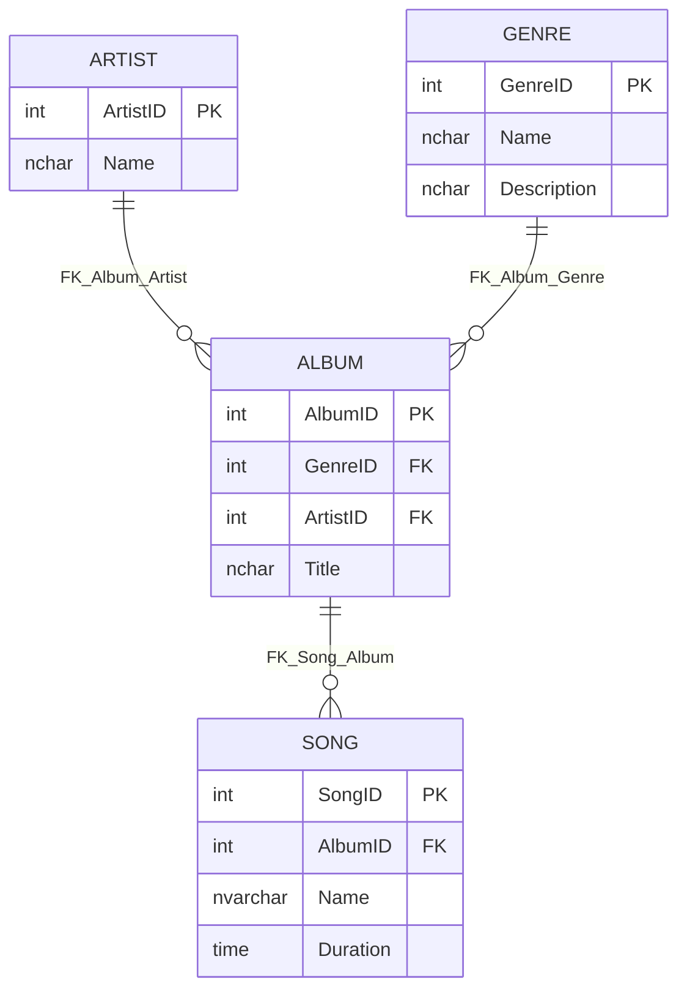

# MusicStore — Current Architecture

> Legacy .NET Framework solution (Visual Studio 2013, .NET 4.5.1) located under `Legacy/`.
> Classic layered N-tier architecture with WCF services, Entity Framework 6 (Database-First EDMX), and multiple client UIs.

## 1. Solution Overview

Solution file: `Legacy/MusicStore.sln` — 13 projects organized in 6 solution folders:

| Layer | Project | Type | Purpose |
|---|---|---|---|
| Shared | `MusicStore.Entities` | Class Library | Domain entities (T4-generated from EDMX) + service DTOs |
| Shared | `MusicStore.Framework` | Class Library | Cross-cutting: NLog logging wrapper (`WrapperLogger`) |
| Data | `MusicStore.Data` | Class Library | Repository interfaces + implementations (thin wrappers) |
| Data | `MusicStore.Data.Repository` | Class Library | EF6 Database-First model (EDMX), `DbContext`, UnitOfWork, generic BaseRepository |
| Data | `MusicStore.Database` | SQL Server Database Project (.sqlproj) | Database schema definition |
| Business | `MusicStore.Business` | Class Library | Business components (`MusicStoreComponent`) |
| Services | `MusicStore.Services.Contracts` | Class Library | WCF `[ServiceContract]` interface (`IMusicStoreService`) |
| Services | `MusicStore.Services` | Class Library | WCF service implementation (`MusicStoreService`, `BaseService`) |
| Hosts | `MusicStore.Hosts.Web` | Web Application (IIS) | WCF service host (`MusicStoreService.svc`) |
| Presentation | `MusicStore.UI.Windows` | WPF App | Windows desktop client (skeleton) |
| Presentation | `MusicStore.UI.Silverlight` | Silverlight App | Browser client (skeleton) |
| Presentation | `MusicStore.UI.Silverlight.Web` | Web Application | Silverlight host page |
| Presentation | `MusicStore.UI.Process` | Class Library | Process/workflow layer (empty scaffold) |
| Tests | `MusicStore.Data.Test` | MSTest | Repository integration tests (hit real DB) |
| Tests | `MusicStore.WCF.Test` | MSTest | WCF service integration tests |

## 2. Layered Architecture

```
┌─────────────────────────────────────────────────────────────┐
│  Presentation                                                │
│  WPF (UI.Windows) · Silverlight (UI.Silverlight)             │
└──────────────────────────┬──────────────────────────────────┘
                           │ WCF (basicHttpBinding, SOAP)
┌──────────────────────────▼──────────────────────────────────┐
│  Hosts: MusicStore.Hosts.Web (IIS, MusicStoreService.svc)    │
├─────────────────────────────────────────────────────────────┤
│  Services: MusicStoreService : BaseService                   │
│            implements IMusicStoreService (Contracts)         │
│            try/catch → ServiceReturn("OK"/"ERROR")           │
├─────────────────────────────────────────────────────────────┤
│  Business: MusicStoreComponent : IMusicStoreComponent        │
│            creates UnitOfWork + repositories                 │
├─────────────────────────────────────────────────────────────┤
│  Data:    RepositoryArtist/Album/Genre/Song                  │
│           inherit BaseRepository<T> (Infrastructure)         │
├─────────────────────────────────────────────────────────────┤
│  EF6 Database-First: MusicStoreEntityContext (EDMX)          │
│  SQL Server (LocalDB) — MusicStore.mdf                       │
└─────────────────────────────────────────────────────────────┘
        Shared: MusicStore.Entities · MusicStore.Framework (NLog)
```

### Request flow (e.g. `GetArtist`)
1. Client calls WCF endpoint (`basicHttpBinding`, IIS-hosted).
2. `MusicStoreService.GetArtist()` (Singleton instance, `ConcurrencyMode.Multiple`) delegates to `MusicStoreComponent`.
3. `MusicStoreComponent` creates a `UnitOfWork` (wraps `MusicStoreEntityContext`) and a `RepositoryArtist`.
4. `BaseRepository.GetAll()` executes `DbSet<Artist>().ToList()` against SQL Server.
5. Result is wrapped in a `ServiceReturn` DataContract (`status` / `responseData` / `exception`); exceptions are logged via NLog and returned as `ExceptionReturn` instead of faults.

## 3. Key Components

### Services layer
- `IMusicStoreService` (`[ServiceContract]`): `GetArtist()`, `GetGenres()` — both return `ServiceReturn`.
- `MusicStoreService`: `[ServiceBehavior(InstanceContextMode.Single, ConcurrencyMode.Multiple)]`; instantiates `MusicStoreComponent` directly (no DI container).
- `BaseService`: logging helpers (`LogServiceException`, `FormatException`) using `MusicStore.Framework` NLog wrapper.
- Host config (`Web.config`): `basicHttpBinding` with maxed-out quotas, metadata enabled, `includeExceptionDetailInFaults=true`, WCF message logging to `myWCFMessages.xml`.

### Business layer
- `MusicStoreComponent` receives an `IUnitOfWork` (default ctor news one up — poor-man's injection, testable via ctor overload).
- Known bug noted in code: `GetGenres()` disposes the repository, which disposes the shared `UnitOfWork`/DbContext before the data is materialized ("Isso não funciona, o Dispose é acionado antes").

### Data layer
- **Two parallel data projects** (historical duplication):
  - `MusicStore.Data` — per-entity interfaces (`IRepositoryArtist`, etc.) and thin repository classes delegating to `MusicStore.Data.Repository`.
  - `MusicStore.Data.Repository` — the real implementation: EF6 EDMX model, `MusicStoreEntityContext : DbContext`, generic `BaseRepository<TEntity>` (Insert/Update/Delete/GetByID/Get/GetAll), `UnitOfWork` with `BeginTransaction/Rollback/Commit` (note: `Roolback` typo; `Commit` calls `SaveChanges` then transaction commit).
- `BaseRepository.Dispose()` disposes the **shared** DbContext — the root cause of the GetGenres bug.

### Entities & data model
T4-generated POCOs in `MusicStore.Entities` (plus `ServiceReturn`/`ExceptionReturn`/`GetArtistResponse` DTOs).



### Cross-cutting
- `MusicStore.Framework`: static `WrapperLogger` over NLog (`NLog.config` in project).
- Connection string: EF Database-First (`metadata=res://*/...`), SQL Server LocalDB `MusicStore.mdf` — **hardcoded absolute path from the original developer's machine** in `Web.config` / `App.config`.

## 4. Technology Stack

| Concern | Technology |
|---|---|
| Runtime | .NET Framework 4.5.1 |
| IDE | Visual Studio 2013 |
| Service layer | WCF (`basicHttpBinding`, IIS-hosted `.svc`) |
| ORM | Entity Framework 6.1.1, Database-First (EDMX + T4) |
| Database | SQL Server / LocalDB (`.mdf` file), `MusicStore.Database` sqlproj |
| Logging | NLog (wrapped by `WrapperLogger`) |
| UI | WPF, Silverlight 5 (+ Silverlight.Web host) |
| Tests | MSTest (integration-style, real database) |
| Serialization | `DataContractSerializer` (`ServiceReturn`, `KnownTypes`) |

## 5. Observations & Technical Debt (relevant for migration)

- **No dependency injection** — everything is `new`-ed up the stack; WCF service is a Singleton.
- **Repository/UnitOfWork lifetime bugs** — disposing a repository disposes the shared DbContext; lazy-loading + dispose patterns are fragile.
- **`ServiceReturn.responseData` is `object`** — weakly typed service contract, relies on `KnownType` attributes.
- **Environment-coupled config** — absolute LocalDB file paths in connection strings; Portuguese comments/messages.
- **Dead/obsolete UIs** — Silverlight (EOL) and an empty WPF shell; `MusicStore.UI.Process` and `MusicStore.Data.Agents` are empty scaffolds.
- **Tests hit the real database** — no mocking/seams; they double as smoke tests.
- **Backup file** `backup.MusicStoreRepository.cs` and duplicated data projects indicate refactoring was in progress when the codebase was frozen.
- **Security posture** — `includeExceptionDetailInFaults=true`, no transport security, maxed quotas.
